<!-- Please do not change this logo with link -->

<a target="_blank" href="https://www.microchip.com/" id="top-of-page">
   <picture>
      <source media="(prefers-color-scheme: light)" srcset="images/mchp_logo_light.png" width="350">
      <source media="(prefers-color-scheme: dark)" srcset="images/mchp_logo_dark.png" width="350">
      
   </picture>
</a>

# Clock Configuration on PIC32CM GC Devices

This example demonstrates how to configure a PIC32CM5112GC00048 device to achieve a synchronous 72 MHz Main Clock Controller (MCLK) and a 4 MHz asynchronous clock. The PIC32CM GC00 Curiosity Nano + Touch Board is used and the clock configuration is done using MPLAB® Code Configurator (MCC) Harmony within Visual Studio Code (VS Code®) through the MPLAB® Extensions for VS Code®.

## Related Documentation

- [PIC32CM Product Page](https://www.microchip.com/en-us/products/microcontrollers/32-bit-mcus/pic32-sam/pic32cm-gc?utm_source=GitHub&utm_medium=TextLink&utm_campaign=MCU8_PIC32CM-GC00&utm_content=pic32cmgc-cnano-clock-config-vscode-harmony-github&utm_bu=MCU08)

## Software Used

- [Visual Studio Code® (VS Code®) v1.142](https://code.visualstudio.com/Download) or newer
- [MPLAB® Tools for VS Code® Extension Pack v1.2.8](https://www.microchip.com/en-us/tools-resources/develop/mplab-tools-vs-code?utm_source=GitHub&utm_medium=TextLink&utm_campaign=MCU8_PIC32CM-GC00&utm_content=pic32cmgc-cnano-clock-config-vscode-harmony-github&utm_bu=MCU08) or newer
- [MPLAB® XC32 v6.00](https://www.microchip.com/en-us/tools-resources/develop/mplab-xc-compilers/xc32?utm_source=GitHub&utm_medium=TextLink&utm_campaign=MCU8_PIC32CM-GC00&utm_content=pic32cmgc-cnano-clock-config-vscode-harmony-github&utm_bu=MCU08) or newer
- [Microchip PIC32CM-GC00 Series Device Support v1.0.27](https://packs.download.microchip.com/#collapse-Microchip-PIC32CM-GC00-DFP-pdsc) or newer

## Hardware Used

- [PIC32CM GC00 Curiosity Nano + Touch Evaluation Kit](https://www.microchip.com/en-us/development-tool/ev23z30a?utm_source=GitHub&utm_medium=TextLink&utm_campaign=MCU8_PIC32CM-GC00&utm_content=pic32cmgc-cnano-clock-config-vscode-harmony-github&utm_bu=MCU08)

   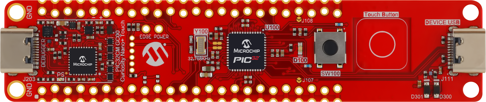
- USB Type-C® cable

## Operation

The clock system is fundamental to the operation of every microcontroller (MCU). It determines the instruction execution speed and generates pulses to provide timing and to synchronize the various peripherals within the device.

The PIC32CM clock system is divided into three main parts:

1.  **Clock sources**: Provide the time base for other components, such as the Generic Clock. Clock sources can be internal or external. Some devices also have Phase-Locked Loops (PLLs).
  
2.  **Generic Clock Controller (GCLK)**: Generates, controls, and distributes asynchronous clocks. The GCLK is composed of programmable prescalers that output the clock signals to the main clock controller and peripherals.
3.  **Main Clock Controller (MCLK)**: Generates synchronous clocks for the system, including the CPU clock and bus clocks — Advanced Peripheral Bus (APB), Advanced High-performance Bus (AHB).

The diagram below shows a simplified clock distribution system.

**Figure 1.** Simplified Clock Distribution Diagram

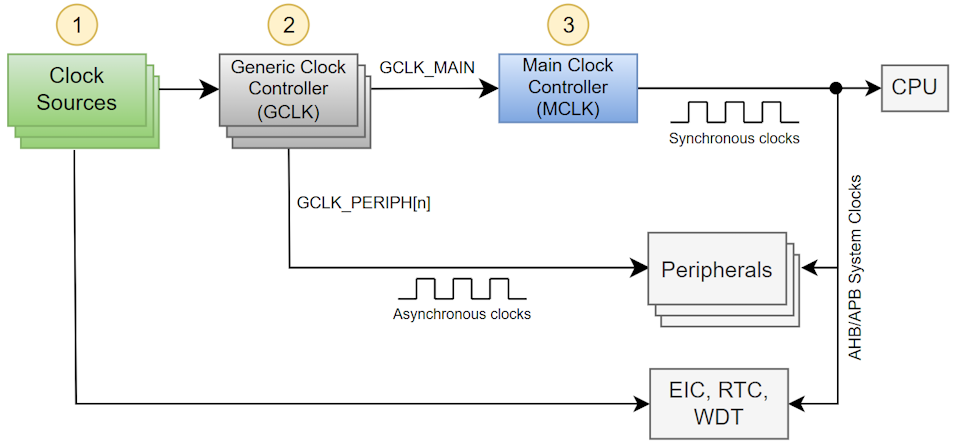

The output of clock sources is the input of the GCLKs, which manage the generation and distribution of asynchronous clocks to the peripherals. In PIC32CM devices, GCLK0 outputs `GCLK_MAIN` which is the input of MCLK. On the other hand, MCLK generates synchronous clocks for the system, including the CPU, AHB, and APB.

Most peripherals are connected to both a bus interface clock (APB/AHB) and a core logic clock (GCLK). Synchronization between these clock domains is essential when the CPU accesses peripheral registers to ensure reliable operation and data integrity. Peripherals such as the Real-Time Counter (RTC) and Watchdog Timer (WDT) are directly clocked from the source.

**Note:** Clock sources and the number of GCLKs vary depending on the device. Refer to the *Clock Distribution* section of the device data sheet for more information.

In this example, the expected outputs are as follows:

-   MCLK: Operates at 72 MHz, with the system timer (SysTick) used to toggle an LED every second.
-   GCLK1: Generates a 4 MHz square wave on the GCLK_IO1 pin.


## Running the Example Project

1. Connect the USB Type-C Debugger Connector of the PIC32CM GC00 Curiosity Nano board to a PC using a USB Type-C cable.
2. If not already in your system, download and install the latest version of VS Code and the MPLAB Tools for VS Code extension.
3. If not already in your system, download and install the XC32 C-Compiler v6.00 or newer.
4. Clone or download this project from GitHub to your local machine.
5. If downloaded as a `.zip` file, extract the files to a location as close as possible to the root directory (e.g., C:/) before moving to the next step.
6. In VS Code, go to _File>Open Folder_. Navigate to the location where the project was extracted and select the `pic32cmgc-cnano-clock-config-vscode-harmony` folder. Click the **Select Folder** button to open the project. The MPLAB extension will automatically detect it as an MPLAB project.

   **Figure 2.** Opening the VS Code® Project

   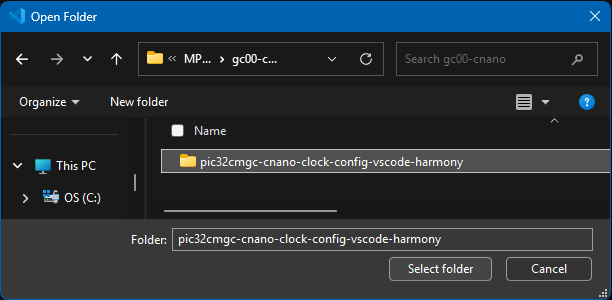

7. Press CTRL + Shift + P to open the command palette. Type "MPLAB CMake: Clean and build" and select it. Choose the default configuration for building the project.

   **Figure 3.** Clean and Build Command

   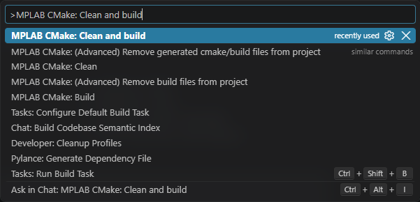

   Wait for the build to finish. Verify that the terminal displays the message "CMake Build successful. (exit code 0)".

   **Figure 4.** Build Successful

   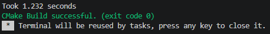

8. Press CTRL + Shift + P again. Type "MPLAB: Program device" and select it.

   **Figure 5.** Program Device Command

   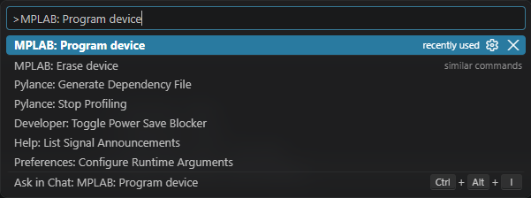

9. Verify that the program is running. LED0 of the PIC32CM GC00 Curiosity Nano board should toggle every ~1s.

   **Figure 6.** Program Complete

    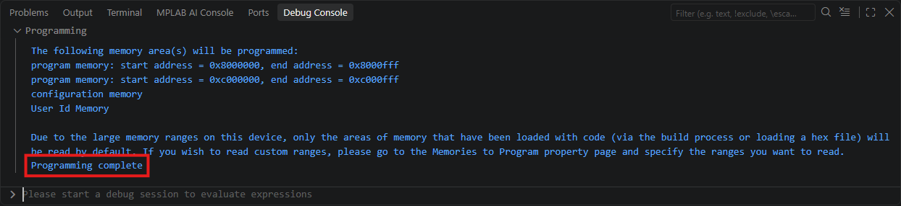

   **Figure 7.** LED Toggle

   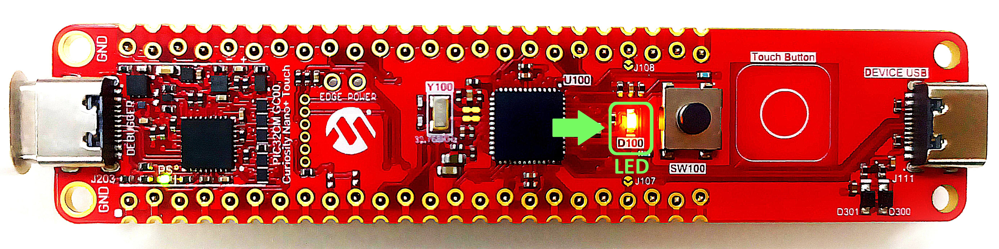

10. To visualize the 4 MHz GCLK1 output, connect a logic analyzer to the PC00 pin of the PIC32CM GC00 Curiosity Nano board.

    **Figure 8.** PIC32CM GC00 Curiosity Nano PC00 Pin

    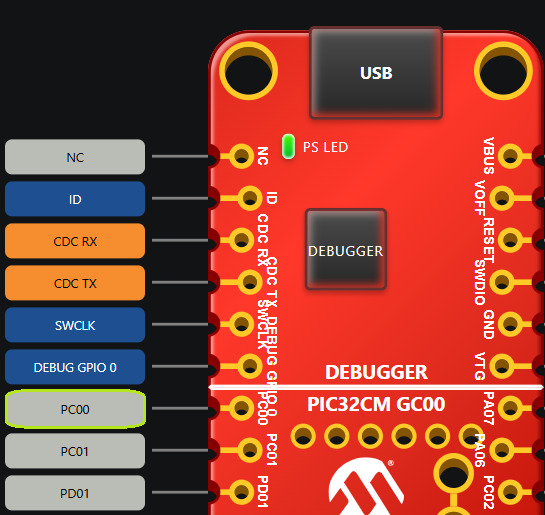

    The output will be similar to the one shown below.

    **Figure 9.** GCLK_IO1 Output

    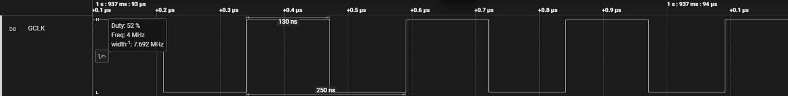

11. <a id="mplab-kit-information"></a>*(Optional)* To look up the details behind the settings used in this example, such as pin assignments and clock configuration, open the **MPLAB: Kit Information** tab by selecting the PIC32CM GC00 Curiosity Nano + Touch kit in the MPLAB view of the VS Code side bar.

    **Figure 10.** MPLAB® Tools

    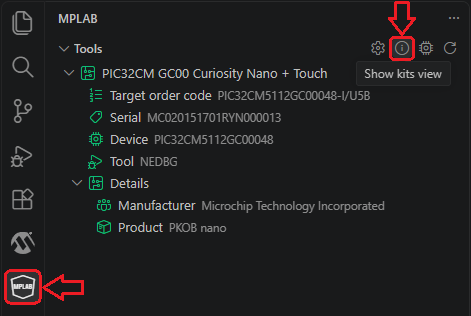
    
    **Figure 11.** MPLAB® Kit Information

    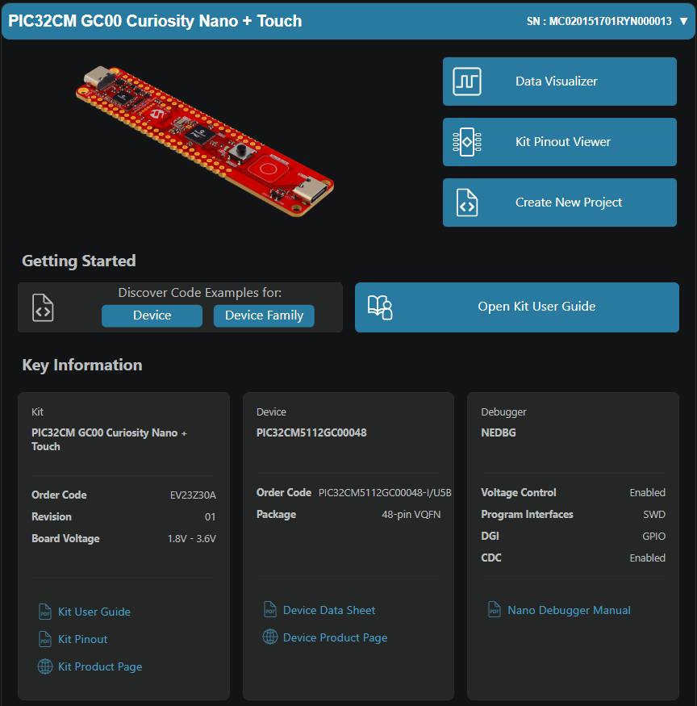

## MPLAB® Code Configurator (MCC) Project Configuration

This example project is preconfigured to work out-of-the-box. To view or verify the configuration of the individual components of the application, the example project can be opened by launching MCC and opening the MCC configuration.

The clock, pins, and system settings are updated for this project. All the other settings are left to their default Harmony configuration.

### Clock Configuration

The interconnection of clock components in this example follows the diagram below. Note that this is just one possible implementation, as there are multiple ways to achieve the desired clock outputs of 72 MHz for MCLK and 4 MHz for GCLK1.

**Figure 12.** Clock Components Routing

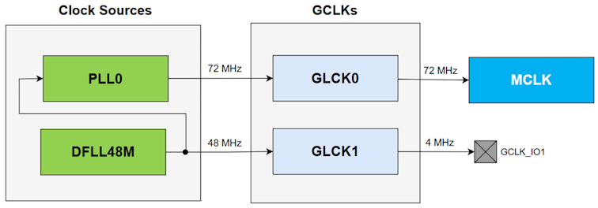

To view the above configuration in Harmony, go to _Plugins>Clock Configurator_. The Clock Configurator window will pop up.

**Figure 13.** Clock Configurator Plugin

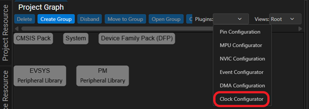

The clock configuration is shown below. The output clocks per block are highlighted in orange, input settings in blue, and other necessary configurations in red.

**Figure 14.** Clock Configuration

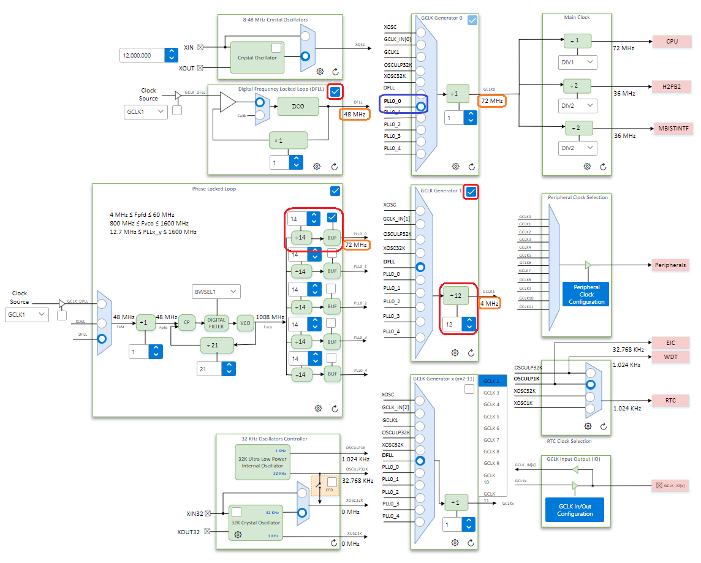

The DFLL48M output is fed to PLL0 to output a 72 MHz clock. PLL0\_0 is used as the input of GCLK0 without any divider to output the same frequency to the Main Clock (MCLK).

DFLL48M is also used as an input to GCLK1. GCLK1 is configured to output a 4 MHz clock on GCLK\_IO1. Clicking the gear icon will show the settings below.

**Figure 15.** GCLK1 Configuration

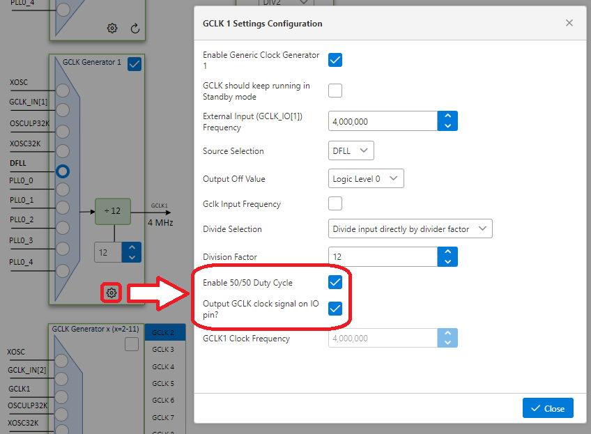

### Pin Configuration

Two General-Purpose Input/Output (GPIO) pins are configured for this example: one for toggling the on-board LED of the PIC32CM GC00 Curiosity Nano connected to PD07, and the other one for the GCLK1 on port PC00. For the pin allocations of the board, refer to the Kit Pinout Viewer or the [Kit User Guide](https://ww1.microchip.com/downloads/aemDocuments/documents/DEV/ProductDocuments/UserGuides/PIC32CM-GC00-Curiosity-Nano-Touch-DS50004123.pdf), both of which can be opened from the **MPLAB: Kit Information** tab (see [Step 11](#mplab-kit-information)).

To view the configuration, go to _Plugins>Pin Configuration_. The Pin Configurator has three tabs: **Pin Settings**, **Pin Table**, and **Pin Diagram**. Select **Pin Settings**.

The pins are set up as shown below. The settings automatically reflect as “Assigned” in the **Pin Diagram** view.

**Figure 16.** MCC Harmony Pins Configuration

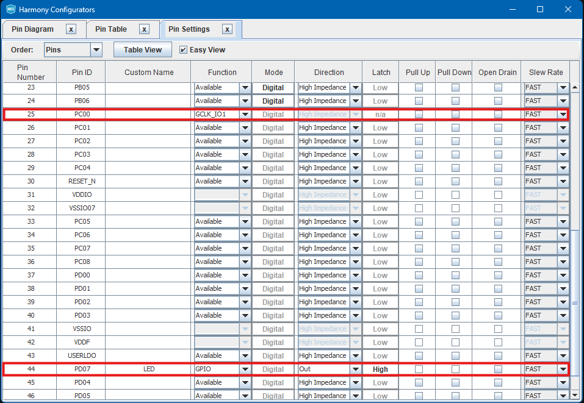

### System Configuration

The ARM&reg; Cortex&reg; CPU includes SysTick, an optional system timer that provides a simple, 24-bit clear-on-write, decrementing, wrap-on-zero counter with a flexible control mechanism. It derives its timing from the CPU, which, in this example, is running at 72 MHz. The SysTick is used to time the LED toggling.

To view if the SysTick is enabled, go to the **Project Graph** and click the System block. In the **Configuration Options**, expand _System>Cortex-M23 Configuration>SysTick_.

**Figure 17.** SysTick Configuration

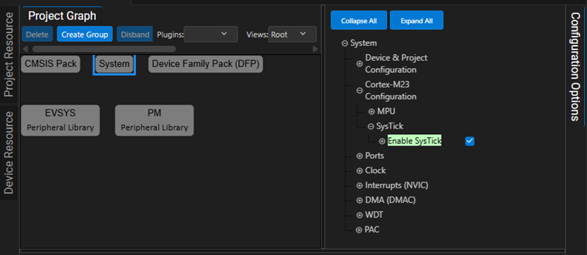

## Application Source Code

The following code is added to `main.c`. This code implements the SysTick timer in Blocking mode. The program waits for a SysTick timer delay of 1s before toggling the LED. The routine runs in a continuous loop.

```c
int main ( void )
{
     /* Initialize all modules */
     SYS_Initialize ( NULL );
     
     /* Start system tick timer */
     SYSTICK_TimerStart();
     
     while ( true )
     {
          /* Toggle LED after every 1s */
          LED_Toggle();
          
          SYSTICK_DelayMs(1000);
     }
          
     /* Execution should not come here during normal operation */
     return ( EXIT_FAILURE );
}
```

## Conclusion

In this example, the PIC32CM GC00 clock was successfully configured to achieve a 72 MHz MCLK for the CPU and output a 4 MHz clock from GCLK1 to a GPIO pin. SysTick was used to blink the LED every 1s.

Understanding how to route the various clock components to achieve the desired frequency for the system and peripherals turns configuring the clock system in MCC Harmony into a straightforward process, achievable in a matter of minutes.